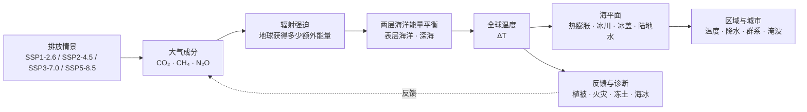

# Overview 重设计方案

> 版本：1.0  
> 日期：2026-10-17  
> 目标页面：`/overview`  
> 设计阶段：只做信息架构、内容叙事、交互和视觉设计，不修改业务代码  
> 设计依据：当前引擎实现、`packages/spec/src/spec/*.yaml`、`docs/10-版本功能规划.md`

---

## 1. 设计结论

当前 Overview 页面把“规格事实源”直接当成“用户介绍页”使用，导致第一次访问的用户会看到大量实体、公式、参数和数据集，却不知道三个最重要的问题：

1. 这个模拟器到底模拟什么？
2. 它是怎样从排放情景得到温度和海平面结果的？
3. 用户打开首页以后，应该怎样操作和理解结果？

新的 Overview 不应该首先展示完整表格，而应该是一场有顺序的产品讲解：

```text
先提出问题
  → 解释模型是什么
  → 展示模型怎样运行
  → 告诉用户怎样使用
  → 说明结果能说明什么
  → 说明结果不能说明什么
  → 最后提供完整规格查阅
```

页面的核心定位改为：

> **未来地球引擎的模型导览与使用说明。**
>
> 让第一次使用的用户在 3 分钟内理解模型，在 5 分钟内完成一次情景实验，并且不会把简化模型误认为天气预报或完整地球系统预测。

---

## 2. 用户与使用场景

### 2.1 主要用户

| 用户 | 他们想知道什么 | 页面需要给什么 |
|---|---|---|
| 第一次访问的普通用户 | 这是什么，能不能玩 | 一句话解释、示例结果、开始按钮 |
| 学生和教师 | 模型如何把排放变成温度 | 简化因果链、变量解释、课堂用法 |
| 气候议题读者 | 不同情景会造成什么差异 | 情景对比、关键年份、结果边界 |
| 开发者和研究型用户 | 具体方程、数据和参数是什么 | 可折叠的规格表、数据源和版本指纹 |
| 分享链接进入的用户 | 这个结果代表什么 | 当前情景、年份、指标和可信度说明 |

### 2.2 用户第一次进入页面时的心理路径

用户通常会按以下顺序判断产品：

1. **我看得懂吗？**
2. **这个结果有依据吗？**
3. **我可以自己试吗？**
4. **我能把它讲给别人吗？**

因此页面的信息顺序应该是“先降低理解成本，再增加技术细节”，而不是一开始展示全部结构化数据。

---

## 3. 当前页面设计评估

| 维度 | 当前评分 | 问题 | 目标评分 |
|---|---:|---|---:|
| 首屏说清产品是什么 | 3/10 | 只有“实体与公式总览”，没有用户问题和结果示例 | 9/10 |
| 模型解释 | 2/10 | 有公式表，没有从输入到输出的故事 | 9/10 |
| 用户操作指引 | 1/10 | 没有告诉用户如何使用地球页 | 9/10 |
| 科学边界说明 | 5/10 | 有 impl 标签，但普通用户看不懂 | 9/10 |
| 技术可追溯性 | 8/10 | YAML、变量、方程、参数和数据集较完整 | 8/10 |
| 信息层级 | 3/10 | 开发者信息和入门信息混在一起 | 9/10 |
| 视觉吸引力 | 5/10 | 深色主题稳定，但页面像表格后台 | 8/10 |
| 传播性 | 2/10 | 没有“试一个问题”和分享入口 | 8/10 |

设计原则是：保留当前规格表作为“深入查阅”，但把它从页面主叙事中降到最后一层。

---

## 4. 页面总结构

Overview 采用纵向 presentation 结构，顶部使用轻量章节导航，页面分成七个区块：

```text
A. Hero：未来地球会怎样？
B. 一分钟看懂：它输入什么、输出什么
C. 模型怎样运行：从情景到地球状态
D. 这个模型具体模拟了什么
E. 具体怎么用：一次完整实验
F. 结果应该怎样理解
G. 完整规格与数据来源
```

顶部导航固定显示：

```text
看懂它  ·  看模型  ·  学会用  ·  看边界  ·  完整规格
```

桌面端可使用右侧章节进度点；移动端使用顶部横向滚动导航。

---

## 5. A 区：Hero——先提出一个用户问题

### 5.1 页面目标

让用户在 5 秒内理解：这是一个可以探索不同未来路径的地球模拟器。

### 5.2 推荐文案

主标题：

> **如果我们走不同的路，地球会变成什么样？**

副标题：

> 选择一个排放情景，拖动时间轴，从 2026 年看到 2500 年的全球温度、CO₂、海平面、冰冻圈和城市变化。

辅助说明：

> 这是一个可运行的教育性气候情景模拟器。它帮助你理解变化的方向、因果关系和量级，不替代天气预报或区域气候预报。

主按钮：

- `进入地球模拟`
- `先看懂模型`

次级信息卡：

```text
4 个排放情景 · 1850–2500 年 · 3D 地球 · 城市级查询 · 不确定性区间
```

### 5.3 视觉设计

Hero 不使用复杂的文字墙，使用当前 3D 地球的静态视觉或轻量缩略图作为右侧主视觉：

- 左侧：标题、说明、两个 CTA。
- 右侧：地球局部、时间轴刻度和三项指标浮层。
- 指标示例：`+2.94°C`、`626 ppm`、`+0.74 m`。
- 指标旁标注 `SSP2-4.5 · 2100`，让用户立即看到产品输出。

视觉重点是“未来状态正在被探索”，不是“技术后台”。

---

## 6. B 区：一分钟看懂

### 6.1 内容目标

用三个问题让非专业用户建立最小理解模型。

采用三张横向卡片：

### 卡片 1：你给它什么？

> **一个未来情景**
>
> 例如：继续高排放、逐步减排，或者更快走向净零。

图标：情景路径 / 排放曲线。

### 卡片 2：它计算什么？

> **地球状态如何变化**
>
> 碳循环改变 CO₂，辐射强迫改变能量平衡，海洋吸热和冰冻圈变化继续影响温度与海平面。

图标：碳循环 + 温度 + 海平面。

### 卡片 3：你能看到什么？

> **全球趋势与城市体验**
>
> 拖动时间轴，观察全球温度、CO₂、海平面、海冰、植被、冻土和城市局地气候变化。

图标：3D 地球 + 城市点。

### 6.2 三卡片下方的单句总结

> **输入一条未来路径，模拟一组地球状态，再把全球结果缩放到地图和城市。**

这句话应该成为整个 Overview 的记忆锚点。

---

## 7. C 区：模型怎样运行

### 7.1 核心 presentation 方式

用一张横向因果流程图替代方程表首屏展示。推荐使用 Mermaid 或自绘 SVG：



### 7.2 图上必须出现的两种语义

使用实线和虚线区分：

- **实线**：进入主求解器的动态耦合链。
- **虚线**：诊断式、模式缩放式或展示层计算。

图例文案：

```text
实线 = 会参与状态演化
虚线 = 根据状态计算的诊断或降尺度结果
```

这一步很关键，因为当前项目有些模块已经实现，但仍是诊断式或聚合箱式，不能让用户误认为全部是同等层级的动态反馈。

### 7.3 四步讲解

流程图下方放四个折叠解释：

#### 第一步：情景进入模型

用户选择 SSP 情景。历史段使用 1850–2024 年的历史排放和观测约束，2025 年以后进入未来情景。

#### 第二步：碳和辐射改变

模型根据大气 CO₂、CH₄、N₂O 和其他强迫，计算地球系统受到的额外辐射能量。

#### 第三步：海洋吸热，温度变化

模型用两层海洋能量平衡表示表层海洋与深海之间的热交换。这样可以表达“升温不会瞬间达到平衡”的时间滞后。

#### 第四步：温度影响冰冻圈和海平面

温度变化会影响冰川、格陵兰冰盖、南极冰盖和海洋热膨胀，最后形成海平面分量和总海平面。

---

## 8. D 区：这个模型具体模拟了什么

### 8.1 不展示 53 个方程，而是展示五个模型层

使用五张层级卡片，每张卡片都包含：

- 普通话解释。
- 技术名称。
- 当前实现层级。
- 主要输出。
- 一个“查看详情”按钮。

#### 层 1：全球气候核心

**一句话：** 地球平均温度和海平面怎样随强迫变化。

**包含：**

- CO₂ 碳收支。
- 温室气体辐射强迫。
- 两层海洋能量平衡。
- 全球平均温度。
- 海平面四分量。

**状态：** 主耦合预测链。

**用户看到：** 温度、CO₂、海平面和海平面构成。

#### 层 2：冰冻圈与碳反馈

**一句话：** 变暖会怎样改变冰川、冰盖、植被、火灾和冻土碳。

**包含：**

- 冰川和冰盖海平面贡献。
- 植被生物量箱。
- 火灾异常碳通量。
- 冻土融化与碳释放。
- 海冰面积诊断。

**状态：** 聚合箱耦合 + 诊断模块。

**必须写明：** 当前不是区域生态系统或完整冰盖动力学模型。

#### 层 3：水循环与区域降尺度

**一句话：** 把全球平均变化转换成纬度带、区域网格和城市条件。

**包含：**

- 纬度带温度放大。
- 基准降水图层。
- 降水、蒸发、径流和土壤水诊断。
- 城市年均温和年降水估计。

**状态：** 诊断式和模式缩放式。

**必须写明：** 不是天气预报，也不是流域水文模型。

#### 层 4：城市与海岸

**一句话：** 选择一个城市，查看它在某个年份的局地气候和简化淹没状态。

**包含：**

- 城市局地升温。
- 年均温和年降水。
- 生物群系分类。
- 基于高程和全球平均海平面的淹没判定。

**状态：** 城市点级降尺度。

**必须写明：** 当前不包含局地沉降、潮汐、风暴潮和防洪工程的完整模拟。

#### 层 5：影响与实验

**一句话：** 把气候状态转换成暴露、适应和情景比较。

**包含：**

- 城市暴露人口。
- 适应能力档位。
- 情景 A/B 对比。
- 阈值首超年份。
- 水资源、热浪、农业、生态和经济损害的教育性估计。

**状态：** 影响函数和教育性估计。

**必须写明：** 影响指标不是观测量，也不是国家级政策预测。

### 8.2 模型层级标签

不要继续使用用户难以理解的 `v0/v1/v2/v3` 作为主标签。推荐主标签改为：

| 用户标签 | 技术含义 |
|---|---|
| 动态耦合 | 进入主状态演化和反馈链 |
| 聚合箱 | 用全球或大区域平均状态表示复杂系统 |
| 诊断估计 | 根据模拟状态计算，不反过来改变主状态 |
| 模式缩放 | 用全球结果估计空间差异 |
| 教育性影响函数 | 用简化经验关系解释潜在影响 |
| 规划中 | 规格中已有，但尚未作为正式结果输出 |

技术详情中再显示原始 `impl`、方程 ID 和 YAML 路径。

---

## 9. E 区：具体怎么用

### 9.1 设计目标

用户看完这一段后，应该可以直接回到地球页完成一次实验，而不需要猜按钮是什么意思。

### 9.2 用“一个问题”教用户，而不是列按钮说明

推荐标题：

> **用一个问题开始：如果世界走 SSP5-8.5，2100 年会怎样？**

用 4 步卡片讲解：

#### 1. 选择情景

在顶部选择 `SSP1-2.6`、`SSP2-4.5`、`SSP3-7.0` 或 `SSP5-8.5`。

提示：

> SSP 是一组未来排放与社会发展路径，不是四个精确的预言。

#### 2. 拖动时间轴

- `2030`：近未来变化。
- `2050`：中期变化。
- `2100`：主要对照年份。
- `2200–2500`：长期探索性外推。

建议在时间轴上直接标出这些关键年份，而不是让用户拖动后才发现。

#### 3. 打开图层

| 图层 | 用户能看到什么 |
|---|---|
| 温度场 | 纬度和区域温度差异 |
| 降水图层 | 基准降水空间分布与变化提示 |
| 淹没模拟 | 高程低于当前海平面上升的陆地区域 |
| 城市点 | 人口规模、高程和城市状态 |
| 不确定性 | 温度、CO₂、海平面区间 |

#### 4. 点选一个城市

城市面板显示：

- 本地升温。
- 年均温变化。
- 年降水估计。
- 生物群系变化。
- 淹没判定。
- 高程数据来源和可靠性标签。

### 9.3 “先试什么”预设入口

Overview 应提供三个一键进入地球页的预设：

1. `看 2100 年的四种未来`
2. `看看我的城市`
3. `看看高排放路径到 2500 年`

每个预设携带 URL 状态，打开后直接定位到对应情景和年份。

---

## 10. F 区：结果怎样理解

### 10.1 四张指标解释卡

#### 温度 ΔT

> 相对于 1850 年基准的全球平均地表温度异常。

注意：这是全球平均，不是你所在城市的实际天气温度。

#### CO₂

> 大气 CO₂ 浓度，单位 ppm。

注意：未来情景段主要采用情景浓度路径，并叠加部分模型反馈，不等于用户输入排放后完全由模型反推的浓度。

#### 海平面 SLR

> 相对于模型起算基准的累计全球平均海平面上升。

注意：这是全球平均海平面，不等于某个海岸城市的局地潮位或风暴潮高度。

#### 不确定性区间

> p10–p90 表示当前参数扰动实验下的结果范围。

注意：它是模型参数不确定性区间，不等于完整的科学共识范围，也不包含所有结构和情景不确定性。

### 10.2 三个“不要误读”提示

用低干扰的黄色提示条展示：

1. **长期结果不是精确预言**：2100 年以后主要用于探索趋势和反馈。
2. **全球平均不是局地天气**：城市条件是降尺度估计，不是天气预报。
3. **颜色不是全部真相**：图层显示的是模型中的一个指标，必须结合单位、年份和图例解读。

---

## 11. 模型说明的深入层级

页面应该提供“简单解释”和“技术细节”两种阅读模式，而不是强迫所有人读同一种内容。

### 11.1 默认：深入浅出模式

默认只展示：

- 一句话解释。
- 一张因果图。
- 关键指标。
- 模型层级标签。
- 使用步骤。
- 适用边界。

### 11.2 展开：技术模式

用户点击“查看技术细节”后再展示：

- 方程 ID。
- 公式。
- 输入与输出变量。
- 参数范围。
- 数据来源。
- 反馈回路。
- 测试门禁。
- 数据 manifest 指纹。

### 11.3 完整规格

页面底部保留当前的完整表格，但标题不要叫“实体与公式总览”，改为：

> **完整规格索引**
>
> 面向希望核对变量、方程、参数和数据来源的用户。

此区域可继续保留：

- 实体/变量表。
- 方程表。
- 参数表。
- 因果回路。
- 数据集表。

并增加筛选：

- 按模型层筛选。
- 按状态/诊断筛选。
- 按当前输出/规划中筛选。
- 按领域筛选。

---

## 12. 推荐页面线框

### 12.1 桌面端

```text
┌────────────────────────────────────────────────────────────┐
│ 🌍 未来地球引擎      地球   模型导览                       │
├────────────────────────────────────────────────────────────┤
│ 章节导航：看懂它 · 看模型 · 学会用 · 看边界 · 完整规格      │
├────────────────────────────────────────────────────────────┤
│                                                            │
│  如果我们走不同的路，地球会变成什么样？       [3D 地球预览] │
│  选择情景，拖动时间轴，观察 2026–2500 年变化    +2.94°C     │
│  [进入地球模拟] [先看懂模型]                       +0.74m │
│                                                            │
├────────────────────────────────────────────────────────────┤
│  你给它什么？          它计算什么？          你能看到什么？   │
├────────────────────────────────────────────────────────────┤
│  情景 → 碳循环 → 辐射 → 海洋 → 温度 → 海平面 → 城市         │
│       [展开四步解释]                                      │
├────────────────────────────────────────────────────────────┤
│  五个模型层                                               │
│  全球核心 | 冰冻圈碳反馈 | 水循环降尺度 | 城市海岸 | 影响实验  │
├────────────────────────────────────────────────────────────┤
│  四步完成一次实验                                          │
│  选情景 → 拖年份 → 开图层 → 点城市                         │
├────────────────────────────────────────────────────────────┤
│  结果如何理解 / 结果边界                                  │
├────────────────────────────────────────────────────────────┤
│  完整规格索引（默认折叠）                                  │
└────────────────────────────────────────────────────────────┘
```

### 12.2 移动端

移动端不使用宽表格作为首屏内容：

- Hero 单列。
- 三张“一分钟看懂”卡片纵向排列。
- 因果链变成可横向滚动的步骤卡。
- 模型层变成手风琴。
- 技术规格默认折叠。
- 页面底部固定“进入地球模拟”按钮。

---

## 13. 视觉方向

### 13.1 总体风格

关键词：

```text
科学展览馆 · 地球观测站 · 未来档案 · 安静而有证据
```

保留当前深色主题，但把“控制台感”降低，把“展览导览感”提高。

### 13.2 色彩语义

| 语义 | 建议颜色 | 用法 |
|---|---|---|
| 主强调 | `#7dd3fc` | 地球、链接、主 CTA |
| 温度 | `#f87171` | 升温、热风险 |
| CO₂/碳 | `#fbbf24` | 浓度、排放和碳收支 |
| 海平面/水 | `#38bdf8` | 海平面、淹没、水循环 |
| 生态 | `#a3e635` | 植被、生物群系 |
| 冻土/不确定性 | `#c4b5fd` | 冻土和区间 |
| 诊断 | `#60a5fa` | 蓝色标签，表示基于状态的估计 |
| 限制/边界 | `#fbbf24` | 黄色提示，不代表错误 |

不要让“绿色 = 好、红色 = 坏”成为唯一表达方式。这里颜色首先表示变量类型。

### 13.3 动画

只使用少量解释性动画：

- 因果链按顺序亮起。
- 模型层卡片在滚动进入时轻微淡入。
- Hero 指标缓慢变化一次。
- 进入地球页时带着当前情景和年份。

避免：

- 公式持续漂浮。
- 所有卡片同时动画。
- 过强的脉冲和发光。
- 影响阅读速度的自动轮播。

---

## 14. 组件和数据设计

### 14.1 新增页面组件建议

```text
OverviewContent
├── OverviewHero
├── QuickStartCards
├── ModelPipeline
├── ModelLayerCards
├── HowToUse
├── ResultReadingGuide
├── ScopeAndLimits
└── SpecificationIndex
```

当前 `OverviewContent.tsx` 可以拆分为以上组件，完整表格迁移到 `SpecificationIndex`。

### 14.2 `OverviewData` 建议扩展

当前 `OverviewData` 只提供 YAML 表格数据。建议增加面向页面叙事的静态内容：

```ts
interface OverviewData {
  product: {
    title: string;
    subtitle: string;
    modelVersion: string;
    timeRange: [number, number];
  };
  modelSummary: {
    inputs: string[];
    outputs: string[];
    driverMode: string;
    modelScope: string;
  };
  pipeline: Array<{
    id: string;
    title: string;
    plainDescription: string;
    technicalDescription: string;
    status: "coupled" | "diagnostic" | "downscaled" | "impact";
    inputs: string[];
    outputs: string[];
  }>;
  usageSteps: Array<{
    title: string;
    description: string;
    action?: string;
  }>;
  limits: Array<{
    title: string;
    description: string;
    severity: "info" | "warning";
  }>;
  // 现有规格索引
  domains: ...;
  variables: ...;
  equations: ...;
  parameters: ...;
  scenarios: ...;
  datasets: ...;
}
```

### 14.3 事实来源原则

叙事文案可以放在一个新的静态 `overview-content.yaml`，但涉及模型事实的内容必须能追溯到：

- 规格 YAML。
- 引擎公开输出。
- 数据 manifest。
- 模型版本和参数指纹。

页面不应手写“全部完成”“完整预测”等超出实际实现范围的表达。

---

## 15. 实现分期

### Phase 1：信息架构与文案

- 拆分 `OverviewContent`。
- 建立 Hero、快速理解、模型链、使用步骤、边界说明。
- 暂时保留旧规格表，移动到页面底部。
- 先不改模型代码。

### Phase 2：模型流程图和状态标签

- 添加因果流程图。
- 将 `v0/v1/v2/v3` 转换为用户层级标签。
- 技术细节中保留原始实现批次和方程 ID。
- 增加“主耦合 / 诊断 / 降尺度 / 影响函数”图例。

### Phase 3：真实使用入口

- 增加三个预设情景按钮。
- 通过 URL 状态进入对应年份和情景。
- 入口按钮指向地球页，不复制模拟逻辑。
- 增加“返回模型导览”链接。

### Phase 4：响应式与可访问性

- 移动端手风琴和底部 CTA。
- 键盘可访问章节导航。
- 色彩对比度检查。
- `prefers-reduced-motion` 支持。
- 公式和表格有可读的替代文本。

### Phase 5：规格索引增强

- 当前表格增加筛选。
- 增加状态标签和数据来源列。
- 增加“为什么显示为诊断式”的解释。
- 允许开发者用户复制方程 ID、变量 ID 和数据集 ID。

---

## 16. 验收标准

### 理解门

- UX-O01：首次访问用户能在 10 秒内说出“输入是什么、输出是什么”。
- UX-O02：用户能用自己的话复述“情景 → 温度/海平面 → 城市”的基本链路。
- UX-O03：用户能区分动态耦合、诊断估计和城市降尺度。

### 使用门

- UX-O04：用户在 30 秒内能进入一个预设情景。
- UX-O05：用户不看额外说明也能完成“选择情景 → 拖年份 → 看指标 → 点城市”。
- UX-O06：用户能从 Overview 返回地球页，并恢复预设年份和情景。

### 信任门

- UX-O07：每个主要结果都有单位、年份和模型层级说明。
- UX-O08：页面明确标出 2100 年以后是探索性外推。
- UX-O09：页面不把全球平均量、城市估计和影响函数混写成同一种预测。
- UX-O10：完整规格中的实体、方程和数据集仍来自规格 YAML，不产生第二事实源。

### 视觉门

- VIS-O01：首屏不出现大表格。
- VIS-O02：页面滚动顺序自然，用户可以只读前 30% 内容而获得足够理解。
- VIS-O03：桌面和移动端都有清晰的主 CTA。
- VIS-O04：流程图、颜色、标签和指标卡使用同一套变量语义。

---

## 17. 最终推荐

Overview 的最终叙事不应是：

> 我们有 53 个方程、若干变量、参数和数据集。

而应是：

> 你可以给未来地球选择一条路径。模型先计算碳和能量如何变化，再计算温度、海平面和冰冻圈如何响应，最后把全球结果转换成地图和城市可以理解的变化。你可以操作它，也应该知道它在哪些地方只是简化估计。

推荐的首版实现顺序：

1. Hero + 一分钟看懂。
2. 因果流程图 + 四步解释。
3. 五个模型层卡片。
4. 具体用法和三个预设入口。
5. 结果解读与边界说明。
6. 完整规格索引折叠化。

先把这六步做好，Overview 就能从“开发者查看规格”升级为“用户理解并开始实验的入口”。